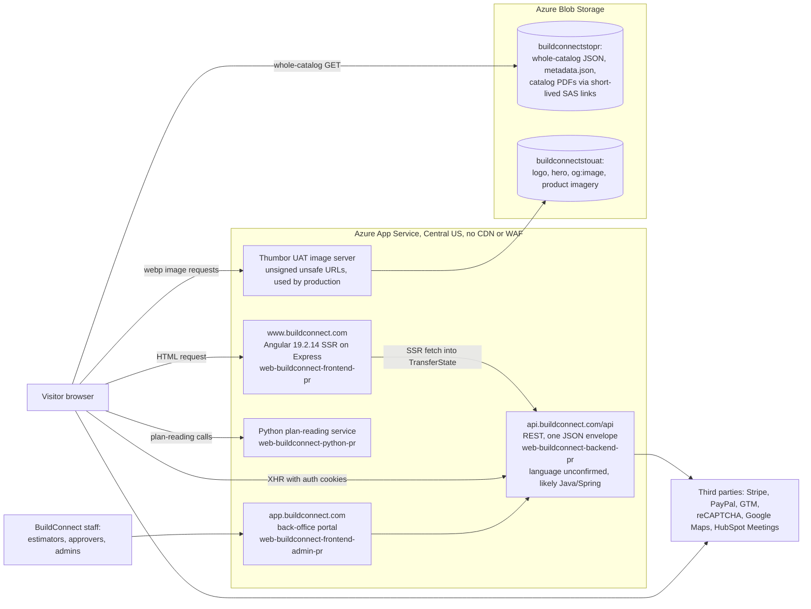
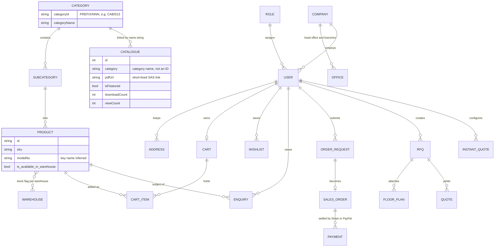
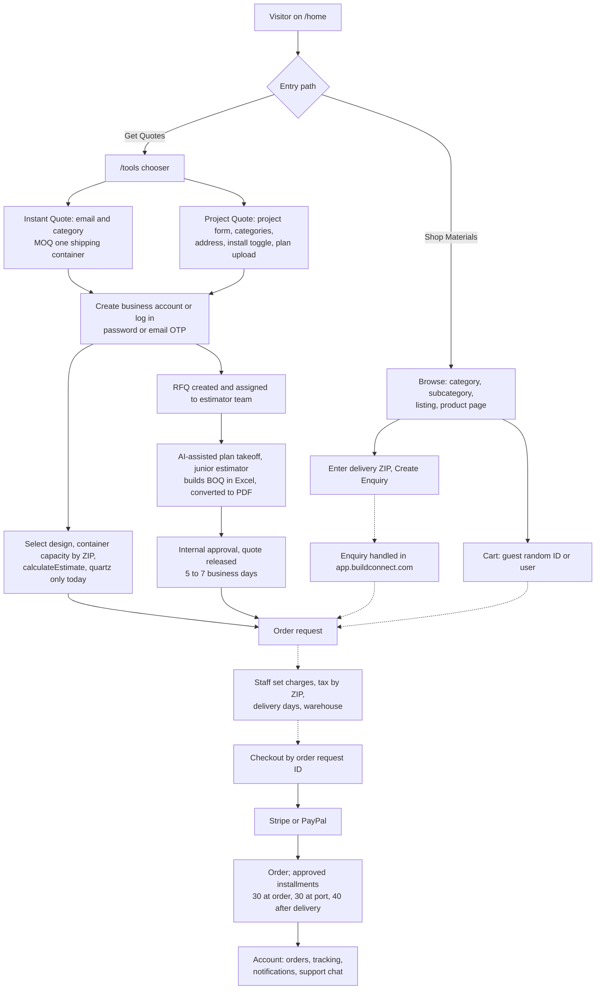

# BuildConnect Turns a Homebuilder's Import Desk Digital

BuildConnect.com (not BuildDirect.com, and not Autodesk's BuildingConnected) is the storefront of **MSRBuildConnect LLC**, a Washington company formed on **May 15, 2024** by the founders of Lynnwood homebuilder MSR Communities and the MSRcosmos IT group. It imports private-label interior finishes (quartz, SPC flooring, cabinets, doors, windows, bathtubs) and sells them to builders as the **seller of record**. It is a direct importer, not a marketplace. Behind a polished rust-and-greige Angular 19 site sits a quote machine. The catalog shows **no prices anywhere**. "Instant Quote" requires a **minimum order of one shipping container**. "Project Quote" sends uploaded plans to staff estimators, who use a Python plan-reading service, build a bill of quantities in **5–7 business days**, and then take a deposit under **30/30/40 installment** terms in which payments are non-refundable. The business is tiny and new. The public launch was around mid-2026. About seven people are visible on LinkedIn, the Similarweb global rank is about **10.2 million**, the catalogs have **three lifetime downloads**, the blog is empty, and the only testimonials come from its sister builder. Its category, finishes supplied to builders, is a fragmented **~$50 billion US market** by Lowe's estimate. But BuildConnect works from one depressed metro, and its import categories were just hit by **25–50% tariffs**. For ConstructDirect, BuildConnect is two things. It is a working blueprint: a plan-upload RFQ with an installation toggle, an estimator back office, and container-aware pricing. It is also an easy target on five fronts: neutrality (it is builder-owned), instant visible pricing, sub-container orders, a real supplier side, and search visibility it has not started to build. Firecrawl had no credits, so pages were captured with curl, WebFetch and Playwright. Product-level catalog data, absolute traffic and some registry details remain open.

## Firecrawl had no credits, so curl, WebFetch and Playwright did the capture

The brief called for Firecrawl, but the connected Firecrawl account returned **"Insufficient credits" on every call**. This teardown therefore contains no Firecrawl scrape, no Firecrawl branding extraction and no Firecrawl screenshot. Three substitutes did the work:

| Tool | What it captured |
|---|---|
| **curl** | Server-rendered HTML, the public JavaScript bundles, the API responses Angular embeds in its TransferState block, response headers, and DNS and RDAP records |
| **WebFetch** | Company, registry-mirror, LinkedIn, Similarweb and competitor pages |
| **Playwright 1.56** (headless Chromium) | **55 screenshots** at 1440×900 desktop and iPhone 13 emulation (390×844 CSS px at 3x), one page at a time, 2.5–3 seconds apart |

All capture was done on **October 21, 2026**. No account was created, no one logged in, and no form was submitted. Enquiry, quote, contact, registration and catalog-download forms were opened but never sent.

Three other routes were closed:
- The Wayback Machine refused connections.
- The official Washington registry (CCFS) served a bot check.
- This session's permission classifier blocked a fetch of the catalog JSON file on Azure Blob. That block is why product-level fields and SKU totals appear as gaps at the end.

The user's own scrape of the home page (`_source_user_scrape.txt`) supplied raw HTML and metadata. It was used only to check details.

## A 2024 LLC run by a Lynnwood homebuilder's founders operates the site

The site's own legal pages settle who runs it. The Terms & Conditions name **MSRBuildConnect LLC** at 806 164th St SW, Building A, 1st Floor, Lynnwood, WA 98037. They set Washington law, with arbitration and venue in King County, and are dated "Last Updated: June 2026" ([Terms](https://buildconnect.com/terms-and-conditions)). The footer adds a second name, "© 2026 Build Connect Inc.", together with a Seattle-area (206) phone number ([About Us](https://buildconnect.com/about-us)). No corporation by that name was found, so the footer line is probably a brand artifact.

A Washington registry mirror lists the LLC as follows ([bizprofile.net](https://www.bizprofile.net/wa/bothell/msrbuildconnect-llc)):

| Field | Value |
|---|---|
| Name | Msrbuildconnect LLC |
| Status | Active |
| Formed | **May 15, 2024** |
| Document no. | 605549709 |
| Governor | Damodar Nagandla |

A sister entity, **Msrsupplyconnect LLC**, was formed the same day with document no. 605549708. Its governor is the group chairman, Sivagopal Modadugula ([bizprofile.net](https://www.bizprofile.net/wa/bothell/msrsupplyconnect-llc)).

The parent link is circumstantial but strong. No page says outright that BuildConnect belongs to the MSRcosmos group, but the evidence points one way:
- **Same building.** MSR Communities, a luxury townhome and single-family builder working in Greater Seattle and Dallas–Fort Worth, sits on the **2nd floor of the same building**. Its footer calls it "an MSRcosmos Group company" ([MSR Communities](https://msrcommunities.com/about-us/)).
- **Same leaders.** Five of BuildConnect's six listed leaders also appear on MSR Communities' roster: Devi K. (Co-Founder), Sivagopal M. (Founder & Chairman), and Partners Nethaji T., Srinivas T. and Damodar N. The sixth, **Prasad Illapani**, is the only BuildConnect-specific partner and is probably the operating lead ([About Us](https://buildconnect.com/about-us)).
- **Same founders as MSRcosmos.** "Sivagopal M." and "Devi K." match the co-founders of MSRcosmos, SivaGopal Modadugula and Devi Kondapi. They are SAP HANA executives who founded that IT-services firm in 2008. MSRcosmos says it has **2,000+ employees** and belongs to a group of **14 companies** ([MSRcosmos](https://www.msrcosmos.com/about-us/)).
- **Same customers.** All three home-page testimonials are from MSR Communities staff: a marketing manager, a director of operations and a construction manager ([home](https://buildconnect.com/home)).

The most likely reading: BuildConnect began as **MSR's in-house import and procurement arm** and is now being productized for other builders.


*The "Meet the Team" row on /about-us. Five of these six names also lead MSR Communities. The Prasad Illapani portrait is a broken image (naturalWidth 0), one of several finish defects noted below.*

Several unrelated businesses share the name, and none of them shares BuildConnect's domain, address or people:

| Look-alike | What it is |
|---|---|
| **BuildDirect** (builddirect.com) | A TSXV-listed online flooring seller ([Wikipedia](https://en.wikipedia.org/wiki/BuildDirect)) |
| **BuildingConnected** | Bid-management software that Autodesk bought for $253M in 2019 ([PitchBook](https://pitchbook.com/profiles/company/62081-38)) |
| **BuilderConnect** | Builder scheduling software from Prosper, Texas ([SoftwareFinder](https://softwarefinder.com/construction/builderconnect)) |
| **NMG Builder Connect** | A buying program from Nationwide Marketing Group launched in November 2025 ([CE Pro](https://www.cepro.com/news/nationwide-marketing-group-announces-nmg-builder-connect-program/623559)) |

The dated record shows a two-year incubation followed by a mid-2026 launch.

| Date | Milestone | Source |
|---|---|---|
| 2008-04-23 | buildconnect.com registered at GoDaddy; registrant masked; probably bought later on the aftermarket | [Verisign RDAP](https://rdap.verisign.com/com/v1/domain/buildconnect.com) |
| 2017 | MSR Communities founded | [MSR Communities](https://msrcommunities.com/about-us/) |
| 2024-05-15 | MSRBuildConnect LLC and MSRSupplyConnect LLC formed | [bizprofile.net](https://www.bizprofile.net/wa/bothell/msrbuildconnect-llc) |
| 2026-01-30 | FAQ categories and entries created (API timestamps) | [FAQs](https://buildconnect.com/faqs) |
| 2026-04 | MSR Communities "and affiliates" ranked No. 10 on Inc. Regionals Pacific, with 778% two-year growth | [Inc.](https://www.inc.com/profile/msr-communities--and-affiliates) |
| June 2026 | Terms and Privacy Policy published | [Terms](https://buildconnect.com/terms-and-conditions) |
| 2026-07-06 to 07-17 | Category images created (decoded from UUIDs); first catalogs (Doors, SPC Flooring) added | [Catalogs](https://buildconnect.com/catalogs) |
| 2026-08 to 09 | Traffic becomes measurable on Similarweb | [Similarweb](https://www.similarweb.com/website/buildconnect.com/) |
| 2026-08-05, 09-08, 10-05 | Windows, Quartz and two Carpet catalogs added, about one a month | [Catalogs](https://buildconnect.com/catalogs) |

The stack around the site shows the same group fingerprints:
- The site runs entirely on Microsoft Azure, which fits a parent that sells SAP-on-Azure services.
- Email runs on Microsoft 365.
- The SPF record includes HubSpot, which points to HubSpot-based sales email ([dns.google](https://dns.google/resolve?name=buildconnect.com&type=TXT)).

## An Angular 19 storefront, an API and a Python takeoff service share one Azure stamp

### Production apps share one App Service stamp, and production loads UAT assets

BuildConnect is an **Angular 19.2.14 single-page app with server-side rendering, non-destructive hydration and event replay**. An **Express** (Node) SSR server serves it on **Azure App Service in Central US**, with **no CDN or WAF** in front ([/home](https://buildconnect.com/home)).

The front end calls a separate REST API at `api.buildconnect.com/api`. That API's language is unconfirmed, but its response envelope, epoch-millisecond timestamps and camelCase verbs suggest Java and Spring.

A separate **Python service** (`web-buildconnect-python-pr`) does plan reading for estimators. Its endpoints are `/predict`, `/highlightObject/`, `/search-text-in-image/`, `/prompt_search/` and `/pdf_search/` ([chunk-AWSVZ7T7.js](https://buildconnect.com/chunk-AWSVZ7T7.js)).

Every public hostname resolves to the same App Service stamp, `waws-prod-dm1-339` ([dns.google](https://dns.google/resolve?name=www.buildconnect.com&type=CNAME)).

| Public host | Azure app | Role |
|---|---|---|
| `www.buildconnect.com` | `web-buildconnect-frontend-pr` | Angular SSR storefront on Express |
| `api.buildconnect.com` | `web-buildconnect-backend-pr` | REST API; CORS locked to `https://buildconnect.com` with credentials |
| `app.buildconnect.com` | `web-buildconnect-frontend-admin-pr` | Back office. Estimators work here, and customers are sent here to view enquiry detail |
| `thumbor.buildconnect.com` | `buildconnect-thumbor-pr` | Production image server. Preconnected, but unused |
| none | `buildconnect-thumbor-uat` | The image server production actually uses |
| none | `web-buildconnect-python-pr` | AI plan-reading service |

The most revealing defect is a **build-configuration leak**. The production bundle contains two environment configurations:
- **Production config:** API, admin and Thumbor URLs, GTM container `GTM-597FXBXW`, a reCAPTCHA key, a Google Maps key, a HubSpot Meetings link, and `ecommerceUrl` pointing at the catalog JSON on Blob ([chunk-AWSVZ7T7.js](https://buildconnect.com/chunk-AWSVZ7T7.js)).
- **Development config,** which `main` imports eagerly ([chunk-3YAEHGNB.js](https://buildconnect.com/chunk-3YAEHGNB.js)). It contains:
  - `api3.buildconnect.test:8080`;
  - a private 10.x address for the AI service;
  - `salestest@test.com`;
  - the **UAT** Thumbor and storage hosts.

The image loader is wired to the second config. As a result, production `/home` references the UAT Thumbor host **60 times** and the UAT storage account **29 times**, including the `og:image` ([/home](https://buildconnect.com/home)).

Images use Angular `NgOptimizedImage` with a custom Thumbor loader. URLs follow the pattern `/unsafe/{W}x0/filters:quality(60):format(webp)/{blobPath}`, which is efficient but unsigned. Third parties could use that server as a free resizing proxy.

Other parts of the client stack:

| Area | What the site uses |
|---|---|
| Components and styling | ng-zorro (Ant Design) components, Tailwind utilities, Swiper web components |
| Cookies and bot checks | `ngx-cookie-service`, `ng-recaptcha` |
| Payments | **Stripe** and **PayPal** |
| Sessions | Cookies `access_token`, `refresh_token` and `userId`. An HTTP 406 triggers a token refresh; any other auth failure redirects to `/login` ([main bundle](https://buildconnect.com/main-AXWYUE3F.js)) |

Every API response uses one envelope:

```
{success, statusCode, responseMsg, errorMsg, response, recordCount, id, accessToken, statusMessage}
```

It mixes epoch-millisecond longs with ISO offset timestamps ([/catalogs](https://buildconnect.com/catalogs)).



### 35 public routes, a three-level material tree and about 30 hidden back-office screens

One Angular route table defines about **35 public routes plus 9 account routes**, served by **47 lazily loaded components**. A constants file shared with the admin app exposes about **30 more back-office route names** ([main bundle](https://buildconnect.com/main-AXWYUE3F.js); [chunk-QDZWIGSS.js](https://buildconnect.com/chunk-QDZWIGSS.js)). There is **no robots.txt, no sitemap.xml and no wildcard 404 route**. Unknown paths fall through to Express's bare "Cannot GET" page ([robots.txt](https://buildconnect.com/robots.txt)).

| Area | Routes | Notes |
|---|---|---|
| Marketing | `/home` (`/` redirects here), `/about-us`, `/contact`, `/contact-form`, `/faqs`, `/blog`, `/blog/:blogUrl` | The blog route is declared twice, and the blog has zero posts |
| Legal | `/privacy-policy`, `/terms-and-conditions`, `/cookie-policy`, `/disclaimer` | Dated June 2026 |
| Materials | `/materials`, `/materials/:category`, `/materials/:category/:subcategory`, `/materials/:category/:subcategory/:id/:sku` | Rendered client-side. Titles are generic ("Build Connect - Material") |
| Quotes and content | `/tools`, `/instant-quote`, `/project-quote`, `/quote-register`, `/catalogs`, `/docs` | The `/tools` title promises "Construction Tools" |
| Commerce | `/view-cart`, `/checkout`, `/checkout/:id`, `/stripe-payment-success` and `-fail`, `/paypal-payment-success`, `-fail` and `-cancel` | The payment result pages require login |
| Auth | `/login`, `/register`, `/createaccount`, `/forgot-password`, `/reset-password`, `/set-password` | Password or email-OTP login |
| Account (role 9) | `/account/dashboard`, `profile`, `change-password`, `wishlist`, `addresses`, `notifications`, `orders`, `orders/track`, `orders/view/:id` | Buyer-only features |
| Back office (`app.buildconnect.com`) | `rfqs`, `rfqs/:id`, `enquiry`, `takeoffs`, `takeoffs-new`, `assigned-rfqs`, `junior-estimator`, `quote-for-approval`, `get-estimation`, `quotes`, `supplier-request-list`, `users`, `staff`, `reports`, `blogs-list`, `api-settings`, `categories`, `subcategories`, `products/:id`, `quality`, `warranty`, `technical-data-sheet`, `our-projects` | Names only; these screens were not visited |

The material tree runs **Category → Subcategory → Product**, which puts a product page four URL segments deep. The public category API returns **16 categories** with `PREFIX/NNN` IDs ([API](https://api.buildconnect.com/api/common/products/category)):

> Tiles TIL/002, Flooring FLO/003, Engineered Stone ENG/001, Carpets CAR/004, "Mirros" (sic) MIR/016, Decking DEC/015, Fencing FEN/014, Cabinets CAB/013, Shower Pans SHO/012, Lighting LIG/007, Doors DOO/008, Windows WIN/009, Garage Doors GAR/010, Bath Tubs BAT/011, Faucets FAU/006, Toilets TOI/005

The `/materials` page renders only 13 of them. The three missing ones (Mirrors, Decking and Fencing) are exactly the categories that have **unfeatured catalogs** in the API, so they appear to be staged but not yet launched. Overall, the catalog API lists **9 catalogs**, and **6** of them are featured on `/catalogs` ([API](https://api.buildconnect.com/api/catelogue/list)).

The mega menu shows roughly **20 subcategories**, most categories holding one to three. The deepest listing observed, Quartz, holds **31 slab SKUs**. The Freestanding Massage Bathtub listing holds 3 ([quartz](https://buildconnect.com/materials/engineered-stone/quartz)).


*The "Explore Materials" mega menu is the most compact view of the site map: 13 uppercase categories, each with one to three subcategories. Cabinets has only "Kitchen Base Cabinets", and that link redirects back to /materials.*

### The whole catalog ships to the browser as one JSON file

The catalog design is the clearest architectural choice to avoid. The API hands the browser a **pointer**, and the browser then downloads one **whole-catalog JSON document** from Blob storage. The product detail component calls `productsJSON(ecommerceJson)`, reads `data.products`, and runs `filterProductByModelNoAndSku` **in the browser** ([chunk-LOPJT7UH.js](https://buildconnect.com/chunk-LOPJT7UH.js)). Listings post to `/products/home/productIds` and count stock with an `is_available_in_warehouse` flag ([chunk-IV5RXV46.js](https://buildconnect.com/chunk-IV5RXV46.js)).

This design has three consequences:
- No product data is server-rendered.
- Every product view costs one large download.
- Per-product SEO is effectively impossible.

The transactional model can be reconstructed from about **180 endpoint names** in the API service ([chunk-AWSVZ7T7.js](https://buildconnect.com/chunk-AWSVZ7T7.js)).

| Domain | Representative endpoints | What it reveals |
|---|---|---|
| Users and auth | `/user/login`, `/user/sendOTP`, `/user/loginWithOtp`, `/user/refreshToken`, `/user/roles/list`, `/user/countries` | Role-based users. Login by password or email OTP. The country list contains only the US |
| Company | `/company`, `/company/office`, `/company/{id}/offices`, `/company/checkIfHOExists/{id}` | B2B accounts with a head office and branches |
| Address and tax | `/address/validate`, `/address/tax`, `/address/info/{zip}` | Tax and validation keyed to ZIP |
| Cart and orders | `/userCart/random/products`, `/orderRequests/create`, `/orderRequests/modify`, `/orderRequests/tax/{zip}`, `/orders/create`, `/payments/stripe/payment/check` | Guest carts, then an order request that staff can modify, then an order |
| Warehouse | `/warehouse/{id}`, `/warehouse/distance/{zip}`, `/orderRequests/deliveryDays/{id}` | Delivery days are computed from the distance between warehouse and ZIP |
| RFQ and estimating | `/rfqs/create`, `/rfqs/floorPlan/upload`, `/rfqs/assign`, `/estimator/juniors`, `/rfqs/estimation/convertExcelToPdf`, `/rfqs/declined/{id}` | A human estimator pipeline whose Excel BOQs are converted to PDF |
| Quotes | `/quote/approveOrReject`, `/quote/status/counts`, `/remarks/save` | Internal approval before the customer sees a quote |
| Instant quote | `/instantquote/formfields/{type}`, `/quote-temp/create`, `/instantquote/capacity?id=&zipCode=`, `/instantquote/calculateEstimate?category=quartz`, `/instantquote/finalizeDesign` | Server-defined forms and autosaved drafts. Container capacity by ZIP. The estimator is **hard-coded to quartz** |
| Engagement | `/enquiries/guestUser`, `/wishlist/add`, `/instant-chat/history`, `/notification/user` | Guest enquiries, chat and notification polling |
| Content | `/catelogue/list`, `/catelogue/activity/track`, `/blogs/home`, `/faq/list` | Catalog download tracking. The blog is empty |

The catalog record is the only product-adjacent object seen in full:
- `id`, `name`
- `category`, which holds a category **name** rather than an ID
- `pdfUrl`, a short-lived read-only SAS link
- `imageUrl`, `isFeatured`, `downloadCount`, `viewCount`
- `createdOn`, `modified`, `lastModifiedBy`, for example "Super Admin"

Product fields beyond `id`, `sku`, a model number and the warehouse flag are unknown, because the catalog file was not fetched.



*Reconstructed from endpoint and function names, not from a schema. Guest carts use a random ID in place of a user. Fields are listed only where they were observed.*

### Three entry paths converge on a staff-priced order request

All three ways to buy end in the same place: an **order request** that staff price before checkout.

| | Shop Materials | Instant Quote | Project Quote |
|---|---|---|---|
| Entry | `/materials` → category → listing → product page | `/tools` → `/instant-quote` | `/tools` → `/project-quote` |
| Minimum order | Set per product, e.g. **36 pieces** for a bathtub | **One shipping container** | None stated |
| Buyer inputs | Delivery ZIP | Email, then a category: Engineered Stone, Flooring or Tiles | Email, company website, quote due date, project name, type and start date, categories, delivery address, "Only for Material" or "Material With Installation", plans (PNG/JPEG/ZIP/PDF) or a cloud link, notes |
| Account wall | Guests can enquire and keep a cart. Wishlist and checkout need login | Step 2 of 5 | Step 2 of 6 |
| Pricing | None shown | Estimate engine (the live endpoint is quartz-only) | Staff-prepared BOQ |
| Turnaround | "Our team will follow up" | "Our team will follow up" | **5–7 business days** |
| Lead time and terms | Estimated delivery time of **120 days** on a bathtub | Container capacity by ZIP | FOB source-country port, delivered to nearest port, or delivered to site. 3- or 4-month options |

Sources for the table: [PDP](https://buildconnect.com/materials/bath-tubs/freestanding-massage-bathtub/BA-FMB-HYDR-587A/BA-FMB-HYDR-WHI-00249-V1), [instant-quote](https://buildconnect.com/instant-quote), [project-quote](https://buildconnect.com/project-quote), [FAQs](https://buildconnect.com/faqs).

The flow below is reconstructed from routes, endpoint names and on-page step panels. Dotted edges are inferred, because nothing after a form submission was observed.




*Instant Quote. The blue notice sets the **one-shipping-container minimum** and sends smaller buyers back to the catalog. Only three categories are offered. The dark step panel numbers its steps 1, 2, 3, 4, 4 and misspells "quanities".*


*Project Quote, BuildConnect's strongest feature. It combines a full RFQ, a "Material With Installation" toggle, plan upload with a cloud-link fallback for large plan sets, and a six-step panel that admits the BOQ is prepared by "our team".*

### Modern rendering, weak operational hygiene

The rendering choices are modern: Angular SSR with hydration, optimized webp images with responsive `srcset`, and lazy routes. Operations lag well behind.

| Area | Finding | Source |
|---|---|---|
| Crawl basics | No robots.txt, no sitemap, no canonical tags, no JSON-LD | [/home](https://buildconnect.com/home) |
| Page structure | **No page has an `<h1>`** | [/home](https://buildconnect.com/home) |
| SSR coverage | Category, listing and product pages server-render without products; listings contain zero "Model#" strings in SSR HTML | [quartz](https://buildconnect.com/materials/engineered-stone/quartz) |
| Payload size | Global CSS is **828 KB** uncompressed; initial JS is about **476 KB** | [/home](https://buildconnect.com/home) |
| Server response | SSR responses took **0.4 s** (`/tools`) to **2.5 s** (`/catalogs`). API calls took 1.1–1.6 s each, with no CDN in front | [/catalogs](https://buildconnect.com/catalogs) |
| Security headers | The HTML has no HSTS, CSP or X-Frame-Options headers and exposes `x-powered-by: Express` | [/home](https://buildconnect.com/home) |
| Code hygiene | `console.log` on every API request. Typos baked into contracts: `/catelogue/`, "Mirros", `BUSSINESS_REGISTER`. Two blog endpoints copy-pasted to `/user/updateStatus` | [chunk-AWSVZ7T7.js](https://buildconnect.com/chunk-AWSVZ7T7.js) |

Taken together, the team invested in **workflow depth** before **discoverability**: RFQ, estimators, AI takeoff, payments and chat came first.

## Warm rust-and-greige polish over a thin catalog with no prices

### A page tour in ten screenshots

The first impression is strong: a full-bleed dusk architecture hero, rust calls to action, and Manrope type. Behind that sits a shallow, priceless RFQ catalog wrapped in full e-commerce chrome.


*The full home page, top to bottom:*
- *hero ("Simplifying Building Materials Procurement");*
- *"Smarter, Connected, Sustainable" cards;*
- *"Projects We Cater To" (the "Commercial Building" photo is BuildConnect's own "806 A" office);*
- *a dark "Built for Enterprise" panel with a mock order showing "Supplier: Build Connect" at $42,500 (Quartz, Shipped) and $118,900 (SPC Flooring, Awaiting Quote);*
- *three testimonials, all from MSR Communities;*
- *"Featured Materials".*

*The blank Featured Materials and Multi Family image slots are a lazy-load artifact of full-page capture. In-viewport captures render them.*


*The Quartz listing at /materials/engineered-stone/quartz is the deepest category, with **31 slab SKUs** (Aureo Nero, Calacatta Blaze, Taj Majesty and others). Every card ends in "Create Enquiry". The page has no price, sort, result count or pagination, and its only facet is "Finish: Polished".*


*The bathtub listing shows the opposite problem: **16 facet groups for 3 products**, with duplicated finish values repeated across facets.*


*The product page is the most complete template. It has:*
- *a gallery;*
- *Model# and Store SKU#;*
- *single-value spec chips;*
- *a "Made to Order" block with **MOQ 36 PCS** and **Estimated Delivery Time 120 Days** in red;*
- *a required ZIP field with "Create Enquiry";*
- *Product Details and Tech Spec accordions;*
- *"Similar Items".*

*The footer carries Built Green, NAHB and Quality Builders Warranty "Proud Member of" badges.*


*/catalogs shows six editorial covers with vertical spine type. Previewing a catalog is ungated. Downloading one opens a lead form asking for name, email and US mobile number. Lifetime downloads across all catalogs total three ([catalogs API](https://buildconnect.com/catalogs)).*


*/blog: "Latest Insights … No Data Found". The blog API returns zero posts and zero categories ([blog](https://buildconnect.com/blog)).*


*Global search after typing "quartz" and waiting 5 seconds. No suggestions appear, Enter does nothing, and no search request leaves the browser, even though a 31-SKU Quartz category exists.*


*Registration offers only a "Business Account (Industry Professionals)": 13 required fields, including company name, website and address. The placeholder ZIP "(eg) 111024" is a non-US six-digit format.*


*Mobile (iPhone 13 emulation), first screen of eight views: hero, hamburger drawer, Browse by Category, bathtub listing, listing with the filter panel collapsed, product page, registration, login. On listings the filter panel opens by default and **pushes every product below the fold**. On the product page, Model# and SKU wrap into cramped columns. The reCAPTCHA badge overlaps content on every page.*

### A one-typeface, rust-primary brand system with contrast slips

The logo is a rust "BC" monogram inside a navy ring, beside the wordmark "Build Connect" and the tagline **"Source Smart, Stay Connected"**. It is served as `BC-logo.svg`, oddly from the UAT storage account ([logo SVG](https://buildconnectstouat.blob.core.windows.net/buildconnect/assets/BC-logo.svg)).

The palette reads as "warm industrial": materials and masonry rather than tech blue. These values come from computed styles on the live DOM ([home](https://buildconnect.com/home); [PDP](https://buildconnect.com/materials/bath-tubs/freestanding-massage-bathtub/BA-FMB-HYDR-587A/BA-FMB-HYDR-WHI-00249-V1)).

| Role | Hex | Use and contrast |
|---|---|---|
| Primary (`--primary`) | **#A04423** rust | Sign Up, Get Quotes, Create Enquiry, eyebrows, active nav. White text on it scores 6.28:1 (passes AA) |
| Logo ring / "BC" / wordmark | #121B26 / #A04424 / #0D0C0A | Logo SVG fills |
| Secondary button | #8C765C taupe | Hero "Shop Materials", hard-coded inline. White text scores 4.32:1, **failing AA** |
| Spec chip | #A3815F | Product-page spec values. White text scores 3.58:1, **failing AA** |
| Page background | #FCF9F8 | `body`. Body text on it scores 8.94:1 |
| Section bands | #E8E4DF / #E3DBD0 | Greige backgrounds |
| Body text / headings | #3C4949 / #1C1917 | Slate-teal body, stone-900 headings |
| Footer and dark panels | #282727 | Footer, "Built for Enterprise" panel, quote-step panels |
| Light tan | #D9C3A8 | Icon tiles |
| Accent (`--accent`) | #3FDBF1 cyan | Declared but **never rendered** |

Typography uses **Manrope** for everything. Self-hosted Figtree font files ship as well, but computed styles never apply them.

| Element | Size / line height | Weight and notes |
|---|---|---|
| Hero (an `<h2>`) | 60/66 px | 400 |
| Section titles (`<h5>`s) | 28.8/43.2 px | 600 |
| Enterprise panel title | 40/48 px | 700 |
| Eyebrows | 16 px | 600, uppercase, 1.6 px tracking, rust |
| Body | 16/24 px | — |

Shape and components:
- Buttons and cards use a **10 px radius**. Buttons are about 40 px tall with 24 px padding, and the header is about 77 px.
- Components are ng-zorro (Ant Design) with Tailwind and custom `bc:`-namespaced classes.
- Icons mix two families: Lucide outline icons in the visible UI and a hidden 49-symbol filled SVG sprite.

The sprite is a roadmap leak. Its symbols include Excel upload, WhatsApp, request-callback, request-meeting, value engineering, track-order, dashboard and payment-error, which points to logged-in features BuildConnect has built or planned ([home scrape](https://buildconnect.com/home)).

The imagery is warm-lit architecture and staged interiors, plus real photos of the company's own office. Several lifestyle images look rendered, and the site's disclaimer says catalog visuals were made with "AI-assisted design tools" ([Disclaimer](https://buildconnect.com/disclaimer)).

The tone is B2B-SaaS abstraction: "A Unified Platform for Sourcing and Delivery", "Ready to source smarter?"

Finish defects undercut the polish:
- placeholder names "(eg) Deo" and "Johndeo@gmail.com";
- a contact-form consent box that talks about "creating an account";
- "Acrylic Bathtub with 3Piece Wall Surround Kit";
- featured images with `alt="undefined"` ([contact](https://buildconnect.com/contact)).

### Discovery features break where buyers need them

Navigation is conventional and works:
- seven top-level items;
- a click-to-open mega menu;
- breadcrumbs;
- a right-side mobile drawer.

Discovery fails in specific, fixable ways:
- Search returns nothing.
- There is no sort, result count, pagination, compare tray or price facet. This is despite home-page copy promising "easy material comparisons".
- Favorites exist only as a heart on the product page.
- "Create Enquiry" on a listing card only navigates to the product page with `?openEnquiry=true`. No form opens.
- The Cabinets path, one of only two "Featured Materials", **dead-ends** back at `/materials` ([cabinets](https://buildconnect.com/materials/cabinets)).

Against peers, BuildConnect trails each on the feature that peer is known for:

| Peer | What the peer offers | BuildConnect equivalent |
|---|---|---|
| **Material Bank** | Next-day multi-brand samples ([Material Bank FAQs](https://www.materialbank.com/faqs)) | None |
| **BuildDirect Pro** | 5 free samples, spend tiers (under $20k, $20k–$49,999, $50k+) and Net 30 for qualifying tiers ([BuildDirect Pro](https://www.builddirect.com/pages/pro)) | None |
| **Home Depot Pro** | Online quotes tied to Preferred Pricing ([Home Depot Pro](https://www.homedepot.com/c/pro_resource_center)) | None |
| **ArchiPro** | Boards and direct messaging with professionals ([ArchiPro](https://resources.archipro.co.nz/about-us)) | None |

BuildConnect's one public advantage over all four is its **plan-upload project RFQ with an installation toggle**.

## Container-scale builders are the real customers

BuildConnect sells to buyers, overwhelmingly business ones:
- **Project types offered:** Commercial Building, Hotels, Multi Family, Single Family, Senior Living and Townhomes.
- **Construction stages:** from "Project Conception and Initiation" through Remodeling and Demolition ([project-quote](https://buildconnect.com/project-quote)).
- **Registration:** business only.
- **Countries:** the API returns only the United States ([register](https://buildconnect.com/register)).

The Terms do name "individual consumers", who see displayed or quoted prices, while "Business customers may contact us directly for pro-pricing schedules" ([Terms](https://buildconnect.com/terms-and-conditions)). In practice, MOQs of 36 pieces or a whole container, plus business-only signup, shut homeowners out.

There is no supplier recruitment at all. The contact form's audience dropdown has exactly three values, and "Supplier" and "Logistics Service Provider" lead only to a contact form ([contact](https://buildconnect.com/contact)).


*"Tell us more about you" offers only Buyer/Purchasing Agent, Logistics Service Provider and Supplier. Combined with the back-office route `supplier-request-list`, this suggests a supplier network is planned but not open.*

### How BuildConnect makes money

The economics are those of a **direct importer**, not a platform. The Terms make Build Connect the seller that sets prices, accepts orders, delivers, takes payment and handles shortages. They also reference "a written warranty for Build Connect branded products", which signals private label ([Terms](https://buildconnect.com/terms-and-conditions)).

The import signature is clear:
- FOB source-country port and port-delivery options;
- a container minimum;
- 3–4 month lead times;
- installments tied to "arrival of Products at the destination port".

No source country is disclosed anywhere.

Revenue is merchant margin on landed cost. Smaller add-ons are installation ("Material With Installation", which the FAQ confirms), sample orders, and cancellation and restocking fees. **No listing fees, supplier subscriptions, commissions, advertising or pricing page** were found ([FAQs](https://buildconnect.com/faqs)).

| Commercial term | BuildConnect position |
|---|---|
| Deposit and installments | "Where approved": **30% at order, 30% on arrival at destination port, 40% within 7 days of delivery** |
| Refunds | "All payments are non-refundable except as expressly set forth" |
| Returns | "All sales are final" unless authorized; restocking fee **up to 25%** |
| Cancellation | Custom or made-to-order goods are non-cancelable; others may carry fees and "non-recoverable supplier expenses" |
| Pickup | No in-person pickup |
| Price visibility | None public; pros get "pro-pricing schedules" on request; tax, shipping and delivery are extra |

Source: [Terms](https://buildconnect.com/terms-and-conditions).

### Strategy

BuildConnect's stated vision is "a secure, digital-first platform that simplifies sourcing, builds trust, and elevates the way materials are delivered". Its claimed differentiators are "Seamless Procurement", "Clarity & Trust" ("Clear pricing, honest timelines") and "Smarter, Sustainable Sourcing" ([About Us](https://buildconnect.com/about-us)).

Several claims have no proof on the site:
- The "clear pricing" promise is contradicted by the absence of a single public price.
- The sustainability claim has no EPDs or certifications behind it.
- The "Proud Member of" badges (Built Green, NAHB, Quality Builders Warranty) look like MSR Communities' builder credentials. They are not supplier certifications.

Recent activity shows a business still filling its shelves: FAQs went up in January 2026, the Terms in June, and catalogs have been added monthly since July.

The strategic logic is coherent: monetize a builder's existing overseas sourcing pipeline by selling container programs to other builders. It carries a **built-in channel conflict**, though. Seattle-area and DFW builders who compete with MSR Communities for land and buyers must share drawings, pipelines and pricing with a competitor-owned supplier.

## Seven staff, nine catalogs, and a $50 billion fragmented niche

### The company is barely visible outside its parent

No revenue, funding or valuation for BuildConnect appears anywhere. Crunchbase, Tracxn, PitchBook and Dealroom searches surface only namesakes. Its weight comes entirely from the group.

| Metric | Value (Oct 2026) | Status |
|---|---|---|
| Employees | LinkedIn band 11–50 (self-reported, matches MSR's band); **7 members** linked; 130 followers ([LinkedIn](https://www.linkedin.com/company/www.buildconnect.com)) | Third-party |
| Web traffic | Similarweb, September 2026 ([Similarweb](https://www.similarweb.com/website/buildconnect.com/)):<br/>global rank **#10,204,748**; US rank #4,037,853<br/>54.39% of traffic from the US<br/>organic search 25.6% of desktop visits<br/>bounce rate 36.97%; 1.14 pages per visit<br/>−6.22% month over month | Third-party estimate |
| Monthly visits | Probably under 5,000, plausibly under 1,000. This is inferred from a rank that sits in Similarweb's long tail; the absolute figure was not retrievable | Estimate |
| Catalog | 16 API categories (13 live), about 20 subcategories, 9 PDF catalogs (6 featured), **3 lifetime catalog downloads**, 0 blog posts ([catalogs](https://buildconnect.com/catalogs)) | Verified |
| Customers | One public reference account (MSR Communities) | Verified |
| Revenue | Under $5M a year; external sales possibly well under $1M (inferred from launch timing, catalog depth and affiliate-only testimonials) | Estimate |
| Parent scale | MSRcosmos: 2,000+ employees, 20 offices, a 14-company group ([MSRcosmos](https://www.msrcosmos.com/about-us/)). MSR Communities: Inc. 5000 No. 678 (2024) and No. 1,617 (2025) ([Inc.](https://www.inc.com/profile/msr-communities--and-affiliates)) | Verified / search snippet |

### The market is large and fragmented, but soft where BuildConnect stands

Analyst sizing of construction materials varies widely, so ranges are the honest unit. The market narrows quickly to the slice BuildConnect actually serves.

| Layer | Size | Source |
|---|---|---|
| Global construction materials (TAM) | $1.57T (2025) to $2.32T (2025), with CAGRs of 4–7% | [Coherent via Barchart](https://www.barchart.com/story/news/33534662/construction-materials-market-to-exceed-usd-1-57-trillion-by-2025-fueled-by-booming-residential-and-commercial-construction); [GlobeNewswire](https://www.globenewswire.com/news-release/2025/10/08/3163498/0/en/Building-Construction-Materials-Market-Size-to-Cross-USD-3-90-Trillion-by-2034.html) |
| US construction put in place | **$2,203.1B SAAR (Aug 2026), −1.7% YoY**; YTD −3.1% | [US Census](https://www.census.gov/construction/c30/current/index.html) |
| US home-improvement and Pro TAM | Home Depot: about $1.1T ($600B Pro, ~15% share). Lowe's: $250B for large Pros | [Home Depot IR](https://ir.homedepot.com/news-releases/2025/12-09-2025-110026216); [Distribution Strategy Group](https://distributionstrategy.com/2025/10/lowes-completes-8-8-billion-acquisition-of-foundation-building-materials/) |
| Builder interior finishes (SAM) | **About $50B, "highly fragmented"**, flooring, cabinets and countertops for builders and property managers | [Pulse 2.0 on Lowe's/ADG](https://pulse2.com/lowes-buying-artisan-design-group-in-1-325-billion-deal) |
| Cross-check | Interior finishes are 24.1% ($103,391) of the cost of a new home (2024). At 940,000 single-family starts forecast for 2026, all finishes including labor come to about $97B | [NAHB](https://eyeonhousing.org/2025/01/cost-of-constructing-a-home-in-2024/); [PHCPPros](https://www.phcppros.com/articles/22957-2026-housing-outlook-ongoing-challenges-cautious-optimism-and-incremental-gains) |
| Puget Sound slice | **About $140–340M a year** (estimate). Annualized 2025 permits of about 6,600 single-family and 7,150 multifamily units × assumed materials-only spend of $15–35k and $6–15k per unit | [MBAKS](https://www.mbaks.com/news/buildersblog/2025/09/26/september-builders-bulletin) for permits; spend per unit is an assumption |
| Obtainable share | 2–5% of Puget Sound in 3–5 years gives about **$3–17M a year**. $50M+ needs multiple metros or structural and MEP categories | Estimate |
| Digital channel | Building-materials e-commerce is $42–50B (2025), only 2–3% of spend. Vendor surveys say 30% of contractor orders were placed online in 2025, and about half of purchases are expected to be digital by 2030 | [Verified Market Research](https://www.verifiedmarketresearch.com/product/home-building-material-ecommerce-platform-market/); [BigCommerce](https://www.bigcommerce.com/blog/b2b-building-and-construction-materials-ecommerce/); [Simon-Kucher](https://www.simon-kucher.com/index%2Ephp/de/node/8377) |

BuildConnect's home market is at a cyclical low:
- Washington residential construction fell to **2013 levels** ([Construction Owners](https://www.constructionowners.com/ca/news/washington-residential-permits-drop-to-2013-levels)).
- Seattle-metro multifamily permits were down 26% through August 2025 ([MBAKS](https://www.mbaks.com/news/buildersblog/2025/09/26/september-builders-bulletin)).

Its import categories also sit directly in the tariff blast radius:
- **Cabinets and vanities** carry a 25% Section 232 duty, which steps up to **50% on January 1, 2027** ([Sandler, Travis & Rosenberg](https://www.strtrade.com/trade-news-resources/str-trade-report/trade-report/january/tariff-increase-delayed-on-furniture-kitchen-cabinets-vanities)).
- **Quartz** has been under a four-year Section 201 safeguard since **August 15, 2026**: 25% in-quota and 50% over-quota in year one, on top of AD/CVD duties. Canada and Mexico are excluded ([Thomson Reuters](https://www.thomsonreuters.com/en-us/help/onesource-global-trade/regulatory-insights/2026/august-4th/us-safeguard-tariff-quota-quartz-surface.html)).

For an importer whose deposit terms already push risk onto buyers, landed-cost swings of 25–50 points on its two flagship categories are a serious exposure.

### The real competitors are big-box roll-ups and regional importers, not marketplaces

| Player | Model and scale | Relevance |
|---|---|---|
| **Lowe's ADG** | Design, distribution and installation of finishes for builders. About $1.8B FY2024 revenue, 3,200+ installers, bought for $1.325B in 2025 ([Pulse 2.0](https://pulse2.com/lowes-buying-artisan-design-group-in-1-325-billion-deal)) | **Most direct**: the same select–supply–install bundle at national scale |
| **Home Depot Pro (SRS, GMS)** | Distribution roll-up; GMS enterprise value about $5.5B, closed September 2025 ([Retail Dive](https://www.retaildive.com/news/home-depots-srs-distribution-deal-acquire-building-products-GMS/751972/)) | Trade credit and delivery network |
| **MSI** | Quartz and flooring importer with a large Kent, WA site ([Stone World](https://stoneworld.com/articles/93035-msi-relocates-to-a-larger-site-serving-the-greater-seattle-area)) | **Direct** on quartz and SPC in Puget Sound |
| **BuildDirect** (TSXV: BILD) | Online flooring plus Pro Centers. Q4 2025 revenue $16.2M, 41.7% gross margin, 81% from Pros ([financialfilings](https://financialfilings.com/filings/builddirectcom-technologies-inc/earnings-release/2026/34487817/)) | Direct on flooring; shows the hybrid model's ~40% margin |
| **Hyphen BuildPro / SupplyPro** | Builder–supplier PO rails. 580+ builders, ~17,500 suppliers, 20 of the top 25 builders ([BusinessWire](https://www.businesswire.com/news/home/20240820110926/en/Hyphen-Solutions-Launches-New-Website-to-Connect-Home-Builders-and-Suppliers-with-Construction-Software-Solutions)) | Incumbent workflow; an integration target |
| **Kojo / Field Materials** | AI procurement SaaS. Kojo: $5B+ a year of purchases through the platform, $10M from Wesco. Field Materials: $10.5M Series A ([Distribution Strategy Group](https://distributionstrategy.com/2025/09/kojo-secures-10-million-investment-from-wesco-expanding-construction-tech-platform/); [SiliconANGLE](https://siliconangle.com/2025/05/05/construction-tech-startup-field-materials-raises-10-5m-automate-materials-procurement/)) | Sets buyers' expectations for AI procurement; aimed at commercial subcontractors |
| **Material Bank, Houzz Pro, ArchiPro** | Discovery and sampling for designers ([BNN Bloomberg](https://www.bnnbloomberg.ca/brookfield-growth-backs-material-bank-at-1-9-billion-value-1.1761621)) | Indirect; specification stage, not builder POs |

## ConstructDirect can win on neutrality, instant prices and search visibility

BuildConnect is not a marketplace incumbent to fear. It is a builder-owned importer with a quoting portal, and almost every structural choice it made leaves an opening. The moves below are ranked by how directly they exploit verified weaknesses.

| # | Move | Why it beats BuildConnect | Evidence |
|---|---|---|---|
| 1 | **Position as the neutral platform**: "we don't build homes and don't compete with you", with contractual confidentiality for project data | Rival builders must hand drawings and pricing to an MSR-owned supplier | Shared founders and building; MSR-only testimonials ([About Us](https://buildconnect.com/about-us)) |
| 2 | **Show prices instantly, with no account wall**: price bands on listings, a live estimate from plan upload, signup only when the quote is ready | Zero public prices; account creation at step 2 of both quote flows; 5–7 day manual BOQ | [instant-quote](https://buildconnect.com/instant-quote); [FAQs](https://buildconnect.com/faqs) |
| 3 | **Serve sub-container and fast-turn demand**: consolidated (LCL) container programs plus domestic-stock SKUs at 1–3 weeks | MOQ of one container or 36 pieces; 120-day lead times push remodelers and custom builders away | [PDP](https://buildconnect.com/materials/bath-tubs/freestanding-massage-bathtub/BA-FMB-HYDR-587A/BA-FMB-HYDR-WHI-00249-V1) |
| 4 | **Build the supply side first**: supplier onboarding, price-file upload, an RFQ inbox, named brands, spec sheets and CAD/BIM files | BuildConnect's "Supplier" role is a contact-form option; it shows no brands | [contact](https://buildconnect.com/contact) |
| 5 | **Compete on terms**: smaller deposits, net-30/60 through a B2B credit partner, a clear return policy, milestone or escrow payments | 30% non-refundable deposit, "all sales are final", restocking up to 25% | [Terms](https://buildconnect.com/terms-and-conditions) |
| 6 | **Make tariffs a feature**: HTS and origin tagging, Section 232, 201 and AD/CVD duty estimates, USMCA alternatives, alerts ahead of the January 2027 cabinet step-up | Its flagship categories just took 25–50% duties | [Thomson Reuters](https://www.thomsonreuters.com/en-us/help/onesource-global-trade/regulatory-insights/2026/august-4th/us-safeguard-tariff-quota-quartz-surface.html) |
| 7 | **Own organic search from day one**: SSR every category and product page; per-page titles, canonicals, `Product`/`BreadcrumbList` JSON-LD, sitemap, robots.txt, one `<h1>` per page; programmatic category × metro pages ("wholesale quartz countertops Seattle"); cost guides and calculators | No sitemap, no `<h1>`, client-rendered listings, empty blog, generic titles | [robots.txt](https://buildconnect.com/robots.txt); [blog](https://buildconnect.com/blog) |
| 8 | **Fix discovery**: typeahead over SKU, color name and category; sort; counts; compare; price and lead-time facets; samples and boards | Search is broken; no sort, compare or samples; Cabinets dead-ends | [quartz](https://buildconnect.com/materials/engineered-stone/quartz) |
| 9 | **Integrate rather than replace**: connect as a SupplyPro supplier or sync with builder ERPs; lead with mid-size and custom builders who don't use Hyphen | Production builders already run on Hyphen rails | [BusinessWire](https://www.businesswire.com/news/home/20240820110926/en/Hyphen-Solutions-Launches-New-Website-to-Connect-Home-Builders-and-Suppliers-with-Construction-Software-Solutions) |
| 10 | **Earn independent proof**: case studies with unaffiliated builders, visible supplier vetting and QC reports | All social proof comes from a sister company | [home](https://buildconnect.com/home) |

The engineering lessons divide cleanly into what to copy and what to avoid.

| Copy from BuildConnect | Avoid |
|---|---|
| SSR with hydration and event replay | Shipping the whole catalog as one browser-side JSON file |
| An optimized-image loader in front of an image proxy | Unsigned `/unsafe/` Thumbor; use signed URLs, imgproxy or a managed CDN |
| One API response envelope | Two environment configs in one build; add a CI check that greps output for `.test`, `uat` and private IPs |
| Short-lived read-only SAS links for PDFs, with download tracking | Category stored as a name string; slashes in IDs (`CAB/013`) |
| Plan-upload RFQ with a material-only vs. material-plus-installation toggle and a cloud-link fallback | Sending customers to a back-office portal for enquiry detail; use one customer workspace |
| Container-capacity-by-ZIP logic for import programs | No CDN, no security headers, `console.log` in production |
| The warm rust and greige palette and editorial catalog covers | Chips and secondary buttons that fail AA contrast; a declared-but-unused accent |

Four risks cut against ConstructDirect too:
- Big-box Pro bundling, with trade credit and installation, is the real long-run competitor.
- Commodity finish margins are thin.
- Acting as merchant of record ties up working capital.
- Puget Sound is at a cyclical low. Starting in, or quickly adding, Sun Belt townhome and multifamily markets reduces single-metro risk. NAHB's mid-2026 multifamily rebound is national ([NAHB](https://www.nahb.org/news-and-economics/press-releases/2026/07/multifamily-gains-lift-overall-starts-despite-single-family-decline)).

Five BuildConnect moves would change the picture and are worth monitoring:
- activation of the Supplier and LSP roles already present in its data model;
- a first blog post;
- the monthly catalog cadence;
- countries beyond the US-only list;
- a Dallas–Fort Worth push that mirrors MSR's Texas footprint.

## What this teardown could not see

| Gap | Why it is open | How to close it |
|---|---|---|
| **Product counts and fields** | The whole-catalog `ecommercejson` blob was not fetched (blocked by the session permission classifier), and listings render only client-side. Unknown: total SKUs, price fields, specs, brands or manufacturers, supplier, country of origin, image arrays, spec-sheet or CAD links. Only observed counts exist: Quartz 31, Freestanding Massage Bathtub 3, about 20 subcategories | One approved GET of the `ecommerceUrl` blob listed in [chunk-AWSVZ7T7.js](https://buildconnect.com/chunk-AWSVZ7T7.js), the same file every public product page downloads |
| **Traffic volumes** | Similarweb's absolute monthly visits were not in the extracted page. Its rank, country split and engagement figures were. Semrush and Ahrefs were not checked. Facebook, Instagram and YouTube follower counts could not be read | An authenticated Similarweb or Semrush pull; manual social checks |
| **Unverified registry details** | The formation date, governor and document number come from the bizprofile.net mirror, because the official WA CCFS served a bot check. The mirror labels the entity type "Limited Liability Limited Partnership", which conflicts with "LLC". No registration exists for the footer's "Build Connect Inc." The domain registrant is masked by Domains By Proxy. The NAHB, Built Green and QBW memberships were not confirmed with those bodies | Manual CCFS lookup; membership directory checks |
| **Ownership statement** | The MSRcosmos / MSR Communities link rests on the shared address, roster, testimonials and the "MSR" entity prefix. No source states it outright | Registry governor and member records; a direct inquiry |
| **Logged-in and post-submit flows** | Dashboard, quote review, order tracking, the enquiry confirmation and live Instant Quote fields were deliberately not accessed | A consented test account |
| **Backend internals** | API language, database and search engine are unconfirmed; GTM container contents and Google Maps key restrictions were not examined | Not testable without intrusion |
| **Performance scores** | Lighthouse and Core Web Vitals were not measured; only curl timings exist | A Lighthouse run |
| **Financials** | No revenue, order volume, customer count or MSR revenue share exists from any primary source | Not public |

## Conclusion

The useful way to read BuildConnect is as a **homebuilder's import desk wearing a platform's clothes**. Its real assets are invisible on the storefront. They are an overseas sourcing pipeline and an estimator back office: RFQ assignment, junior-estimator BOQs and AI-assisted plan takeoff. The "Smarter, Connected" positioning and the supplier-network language describe a future it has wired into its data model (Supplier and LSP roles, a `supplier-request-list` screen) but not yet switched on.

That has two implications for ConstructDirect. First, the near-term threat is small. A single-metro, builder-owned importer with one reference customer, no public prices and a site search engines cannot read will not lock up the mid-market. Second, BuildConnect launched into the worst possible tariff window for its two flagship categories. That pressure is the most likely trigger for it to pivot from importer to multi-supplier platform. If it does, its existing estimator workflow and builder relationships will matter.

ConstructDirect's durable edge therefore should not be prettier pages, which BuildConnect already does reasonably well. It should be the three things a builder-owned importer structurally cannot offer:
- **neutrality;**
- **transparent, tariff-aware landed pricing across many suppliers;**
- **a supply side that is open before BuildConnect opens its own.**
